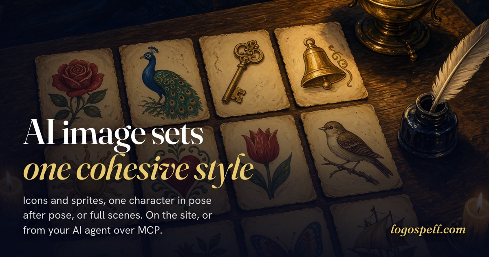

<p align="center">
  
</p>

# Setup

1. Sign up at [logospell.com](https://logospell.com): free starter
   credits, no card required.
2. Copy the API key from your account page.
3. Connect your client. Logospell is a hosted MCP server, so there is
   nothing to build or run locally.

More clients, with step-by-step setup: [logospell.com/connect](https://logospell.com/connect)

### Any MCP client

Endpoint: `https://mcp.logospell.com/mcp` (streamable HTTP, bearer API key).

```json
{
  "mcpServers": {
    "logospell": {
      "type": "http",
      "url": "https://mcp.logospell.com/mcp",
      "headers": { "Authorization": "Bearer ls_<your-key>" }
    }
  }
}
```

Agent-assisted setup: see [llms-install.md](llms-install.md).

### Claude Code

```
/plugin marketplace add logospell/logospell-mcp-server
/plugin install logospell@logospell
```

Claude Code asks for your API key when it enables the plugin.

### Grok Build

```
grok plugin install logospell/logospell-mcp-server --trust
```

Then set `LOGOSPELL_API_KEY` in your environment.

### Cursor

Save the `mcp.json` from the Cursor tab at
[logospell.com/connect](https://logospell.com/connect). Signed in, it
has your key filled in.

### Gemini CLI

```
gemini extensions install https://github.com/logospell/logospell-mcp-server
```

Gemini CLI asks for your API key when it installs the extension.

<br>

# MCP Tools

## Make a set

### `generate_image_set` · 1 credit

A cohesive set of separate subjects in one style, such as icons, game assets or UI elements, on one solid background color or transparent (`background: "transparent"`), so each image drops onto any backdrop. You set the style (in words, with up to 3 reference images, or both), up to 16 subjects, the background, an exact size or native resolution, how each subject fills its frame, the margin, the format and quality, and each file's name. A finished set can be grown with [`extend_image_set`](#extend_image_set--1-credit), delivered again with [`edit_set`](#edit_set--free), or exported for the web, iOS, Android and Flutter with [`export_set`](#export_set--free).

**On a solid color**

<table>
  <tr>
    <th colspan="4" align="left">Your agent asks for</th>
  </tr>
  <tr>
    <td colspan="4"><samp><b>style</b></samp><br>Persian miniature painting fused with illuminated-manuscript gold leaf and Mughal floral border ornament<br><br><samp><b>subjects</b></samp><ul><li>an astrolabe</li><li>a hunting falcon</li><li>a pomegranate</li><li>a brass lantern</li><li>a lute</li><li>a peacock feather fan</li><li>a camel</li><li>a domed pavilion</li><li>a scimitar</li><li>an hourglass</li><li>a chess knight</li><li>a cypress tree</li><li>a tiger</li><li>an elephant</li><li>a quill and inkwell</li><li>a crescent moon</li></ul><samp><b>background</b></samp><br>#2b1d3a</td>
  </tr>
  <tr>
    <th colspan="4" align="left">Your agent receives</th>
  </tr>
  <tr>
    <td align="center"></td>
    <td align="center"></td>
    <td align="center"></td>
    <td align="center"></td>
  </tr>
  <tr>
    <td align="center"></td>
    <td align="center"></td>
    <td align="center"></td>
    <td align="center"></td>
  </tr>
  <tr>
    <td align="center"></td>
    <td align="center"></td>
    <td align="center"></td>
    <td align="center"></td>
  </tr>
  <tr>
    <td align="center"></td>
    <td align="center"></td>
    <td align="center"></td>
    <td align="center"></td>
  </tr>
  <tr>
    <td colspan="4"><sub>Delivered at 500x540, the set's native size. Shown here from <code>export_set</code> at base size 128.</sub></td>
  </tr>
</table>

**Transparent**

<table>
  <tr>
    <th colspan="4" align="left">Your agent asks for</th>
  </tr>
  <tr>
    <td colspan="4"><samp><b>style</b></samp><br>Art Nouveau stained glass with dark lead lines and jewel-toned glass panes<br><br><samp><b>subjects</b></samp><ul><li>a peacock</li><li>a dragonfly</li><li>a calla lily</li><li>an iris</li><li>a swan</li><li>a hummingbird</li><li>a monarch butterfly</li><li>a koi fish</li><li>a snail</li><li>a barn owl</li><li>a rose</li><li>a lotus</li><li>a heron</li><li>a fox</li><li>a seahorse</li><li>a pinecone</li></ul><samp><b>background</b></samp><br>transparent</td>
  </tr>
  <tr>
    <th colspan="4" align="left">Your agent receives</th>
  </tr>
  <tr>
    <td align="center"></td>
    <td align="center"></td>
    <td align="center"></td>
    <td align="center"></td>
  </tr>
  <tr>
    <td align="center"></td>
    <td align="center"></td>
    <td align="center"></td>
    <td align="center"></td>
  </tr>
  <tr>
    <td align="center"></td>
    <td align="center"></td>
    <td align="center"></td>
    <td align="center"></td>
  </tr>
  <tr>
    <td align="center"></td>
    <td align="center"></td>
    <td align="center"></td>
    <td align="center"></td>
  </tr>
  <tr>
    <td colspan="4"><sub>Delivered at 557x556, the set's native size. Shown here from <code>export_set</code> at base size 128.</sub></td>
  </tr>
</table>

<br>

### `generate_character_set` · 1 credit

A set of one character, such as a mascot, creature, person or single product, one variation of it per image: sticker and reaction packs, mascot poses, a product shown many ways. You describe the character in words (`character`), show it in up to 3 reference images (`characterReferences`, the most faithful way to keep one specific character), or both, and say what it is doing in each image (`variations`, up to 16). The background (a color or transparent), size, sizing, margin, format and quality controls are `generate_image_set`'s. A finished set can be grown with [`extend_character_set`](#extend_character_set--1-credit), delivered again with [`edit_set`](#edit_set--free), or exported with [`export_set`](#export_set--free).

<table>
  <tr>
    <th colspan="4" align="left">Your agent asks for</th>
  </tr>
  <tr>
    <td colspan="4"><samp><b>character</b></samp><br>a wise old tortoise wearing a small jeweled crown, rendered as Byzantine gold-tessera mosaic fused with Celtic illuminated-manuscript knotwork across its shell<br><br><samp><b>variations</b></samp><ul><li>waving hello with a gentle smile</li><li>laughing so hard it tips onto its back</li><li>reading an unrolled scroll with a skeptical squint</li><li>sleeping with its head tucked halfway into its shell</li><li>dancing on its hind legs overjoyed</li><li>glaring in slow-burning silent fury</li><li>holding up a lantern with wide-eyed curiosity</li><li>weeping big tears of relief</li><li>shrugging mildly baffled</li><li>playing a small lute lost in the music</li><li>jumping back in shock with eyes wide</li><li>shyly offering a single flower</li><li>raising a goblet in a proud toast</li><li>meditating with eyes closed and perfectly calm</li><li>pointing ahead fiercely determined</li><li>hiding its face behind its crown in embarrassment</li></ul><samp><b>background</b></samp><br>#1e2a3a</td>
  </tr>
  <tr>
    <th colspan="4" align="left">Your agent receives</th>
  </tr>
  <tr>
    <td align="center"></td>
    <td align="center"></td>
    <td align="center"></td>
    <td align="center"></td>
  </tr>
  <tr>
    <td align="center"></td>
    <td align="center"></td>
    <td align="center"></td>
    <td align="center"></td>
  </tr>
  <tr>
    <td align="center"></td>
    <td align="center"></td>
    <td align="center"></td>
    <td align="center"></td>
  </tr>
  <tr>
    <td align="center"></td>
    <td align="center"></td>
    <td align="center"></td>
    <td align="center"></td>
  </tr>
  <tr>
    <td colspan="4"><sub>Delivered at 576x548, the set's native size. Shown here from <code>export_set</code> at base size 128.</sub></td>
  </tr>
</table>

<br>

### `generate_illustration_set` · 1 credit

A set of composed pictures in one style, such as scenes, hero images, banners, posters or portraits, one picture per scene and up to 6 per call. You set the style (in words, with up to 3 reference images, or both), the scenes, the size (every picture in a call shares one, from a fixed list of shapes running from 8:1 to 1:8), and the format and quality. Without style references, the first scene is drawn first and the rest are drawn to match it. A finished set can be grown with [`extend_illustration_set`](#extend_illustration_set--1-credit), at its size or another from the list, delivered again at another of its own sizes with [`edit_set`](#edit_set--free), or exported for apps and sites with [`export_set`](#export_set--free).

<table>
  <tr>
    <th colspan="3" align="left">Your agent asks for</th>
  </tr>
  <tr>
    <td colspan="3"><samp><b>style</b></samp><br>Byzantine icon painting fused with Persian miniature detail and Celtic illuminated borders, with gold-leaf skies and jewel-toned pigments<br><br><samp><b>scenes</b></samp><ul><li>a pilgrim caravan crossing a desert pass at golden dusk, lanterns swinging from the camels</li><li>a monastery on a sea cliff at dawn with monks ringing bells as gulls circle</li><li>a night market in a domed city under a starry sky, merchants lit by brass lamps</li><li>a scholar reading in a tiled library at noon, sunlight falling through latticed windows</li><li>a royal hunt in a cypress forest at morning, falcons launching from gloved wrists</li><li>a harbor of carved ships at moonrise with a lighthouse burning on the mole</li></ul><samp><b>width</b></samp><br>1696<br><br><samp><b>height</b></samp><br>2528</td>
  </tr>
  <tr>
    <th colspan="3" align="left">Your agent receives</th>
  </tr>
  <tr>
    <td align="center"></td>
    <td align="center"></td>
    <td align="center"></td>
  </tr>
  <tr>
    <td align="center"></td>
    <td align="center"></td>
    <td align="center"></td>
  </tr>
  <tr>
    <td colspan="3"><sub>Delivered at 1696x2528. Shown here from <code>export_set</code> at base size 394.</sub></td>
  </tr>
</table>

<br>

## Grow a set

### `extend_image_set` · 1 credit

Add more subjects to a set made with `generate_image_set`, generated exactly as the set was: the same style text and style references, and the background (a color or transparent), size, format, quality, margin and sizing of the batch you name, so a set grows past the 16-subject limit of one call without drifting. A set styled by text alone is sent up to 3 images from its first batch, so the new subjects are drawn like the rest. The new batch joins the set, and the whole set's download window restarts.

<br>

### `extend_character_set` · 1 credit

Add more variations to a set made with `generate_character_set`, generated exactly as the set was: the same character text and character references, and the background (a color or transparent), size, format, quality, margin and sizing of the batch you name, so a set grows past the 16-variation limit of one call. A set made from text alone is sent up to 3 images from its first batch, so the new variations are drawn like the rest. The new batch joins the set, and the whole set's download window restarts.

<br>

### `extend_illustration_set` · 1 credit

Add more scenes to a set made with `generate_illustration_set`, drawn exactly as the set was: the same style text and style references, and the format and quality of the batch you name, at its size or any other size the tool lists, so one set can hold a wide hero and tall posters. A set made from text alone is sent up to 3 images from its first batch, so the new scenes are drawn like the rest. The new batch joins the set, and the whole set's download window restarts.

<br>

## Deliver a set again

### `edit_set` · free

Change how an existing image set, character set or illustration set is delivered, without generating again. On an image or character set: `width` and `height` (both, one, or neither, as on the set tools), `canvas` (with no size fixed: `uniform` for one canvas across the set, `subject` to wrap each image around its own subject), `minimumMargin`, `sizing` (relative or fill), `format` and `quality`, and for a transparent set `background` (a `#RRGGBB` color to compose over, or `"transparent"`). On an illustration set: `width` and `height` together, as one of the batch's own sizes (the size its scenes were drawn at, or an exact half, quarter and so on of it, down to 256 pixels on the shorter side), `format` and `quality`. Or `reset`, to return to the set as it was first delivered. Takes the set's `generation` id; a setting left out keeps its current value. The set is cut again from its full-resolution source and its download is replaced in place, so the same URL serves the new delivery. What the pictures show cannot be edited.

<br>

### `export_set` · free

Export an existing set for the web, iOS, Android and Flutter at the base size `baseSize` you name: every image at every density each platform needs, laid out as each expects, with a viewer and a ledger that says per tree whether any file has some blur. An image or character set exports as icons, at base sizes from 16 to 256; an illustration set exports its scenes whole, up to its `crispBaseSize` (a quarter of the longest side its scenes were drawn at), so it is always crisp. One batch and one size per call; `format` and `quality` default to the set's current ones. Every example image on this page came from it.

<br>

## Reference images

### `create_reference` · free

Create an upload slot for a reference image: you get back a ref_
token and a one-line curl upload command. Pass the token to whichever
tool takes reference images: `styleReferences` on `generate_image_set`
and `generate_illustration_set`, `characterReferences` on
`generate_character_set`, up to 3 each. To use an image from one of
your own recent generations, skip the upload: pass `sourceGeneration`
and `sourceImage` and the server copies that image in. To grow an
existing set, use its extend tool instead.

<br>

### `list_references` · free

List your live reference images, most recently used or uploaded first, with each one's `ref` token, upload URL and expiry, to recover a token you lost instead of uploading the image again.

<br>

### `delete_references` · free

Permanently delete one or more references you created with [`create_reference`](#create_reference--free), before they expire on their own: pass their tokens in `refs`, and the images are removed and the tokens stop working. Only the API key that created a reference can delete it.

<br>

## Your generations and credits

### `list_recent_generations` · free

List your recent generations, a page at a time, and get their download
URLs again, for example to recover a result lost to a dropped
connection. Generations made on the generate page at logospell.com
appear here too.

<br>

### `get_generations` · free

Get the full record of generations whose ids you have: download link and expiry, current delivery settings, where its reference images came from, and the prompt.json with the original call, so the generation can be extended or reproduced. Takes a `generations` list of ids.

<br>

### `delete_generations` · free

Permanently delete one or more of your generations before their download window closes: each download URL stops working, and the images and the source kept for edits and exports are removed. Takes a `generations` list of ids; pass all of a set's ids to delete the whole set. Only the API key that made a generation can delete it; there is no undo, and credits are not refunded.

<br>

### `check_credits` · free

Check how many image generation credits remain on your account: one
balance shared by your MCP calls and the logospell.com generate page.

<br>

### `buy_credits` · no charge to call

Get a Stripe Checkout link that buys 1 to 10 credit packs (`packs`,
default 1) for the account your API key belongs to, with no sign-in.
Open it, or hand it to your user, to pay with a card or Link; the
credits land on the key within seconds of payment.

<br>

# Network and credentials

Logospell's plugins talk only to `mcp.logospell.com`: the MCP endpoint
(`https://mcp.logospell.com/mcp`) plus the time-limited download URLs
its results return on the same host. They authenticate with your
`LOGOSPELL_API_KEY` as a bearer token, sent only there. No third-party
endpoints, no client-side telemetry; service calls are recorded
server-side as described in the privacy policy.

<br>

<p align="center"><a href="https://logospell.com/docs">Docs</a> · <a href="https://logospell.com/privacy">Privacy</a> · <a href="mailto:support@logospell.com">Support</a> · <a href="https://registry.modelcontextprotocol.io/?q=com.logospell">MCP Registry</a></p>

<p align="center"><a href="https://glama.ai/mcp/connectors/com.logospell/logospell"></a></p>
